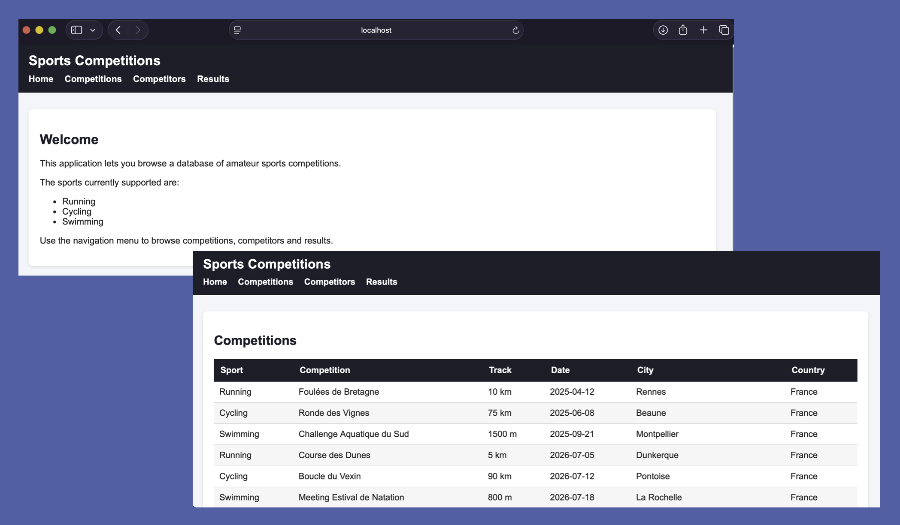
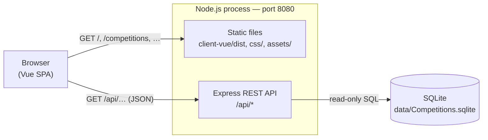

# Competitions WebApp

*Last updated: October 13, 2026*

## Overview

This web application displays and queries various sports competitions results: cycling, running and open-water swimming.

1) V0.1 is a prototype - a lightweight 3-tier monolith with:
     - a presentation layer coded in HTML, CSS, Javascript. No JS framework
     - a business logic layer, with JSON endpoints APIs written in PHP
     - a data layer made of a lightweight SQLite database
     - This version will run on a clustered server, executing SQLite and PHP.

2) V0.2 will be a shift to a more modern web app architecture (still in 3-tier):
     - a presentation layer coded in HTML, CSS, Javascript (React.js or Angular.js or Vue.js)
     - the business logic layer will include REST APIs instead of PHP JSON endpoints
     - the data layer will be migrated from SQLite to Azure SQL database
     - This more advanced version will run on a clustered server as well.

## Authors and contributors

| Topic | Sub-topic | Author/Contributor |
|---|---|---|
| Project management | JIRA | gk-solve |
| Project management | Versioning with Git | gk-solve |
| Functional design | | gk-solve |
| Technical architecture design | Pattern choice | gk-solve |
| Technical architecture design | Components and frameworks | gk-solve |
| Development | Code writing (HTML/CSS/JS + SQL DDL) | Claude Code |
| Development | Code comments | Claude Code |
| Development | Cloud services set up | - |
| Testing | Test environment set up | Claude Code |
| Testing | Tests execution | gk-solve |
| Documentation | README file | Claude Code + gk-solve |

## Screenshot



## Current status (as of October 13, 2026 — V0.2 in progress)

| Layer | V0.1 | V0.2 today | Next step |
|---|---|---|---|
| Presentation | HTML/CSS + vanilla JS | **Vue.js** single-page app ✅ | — |
| Business logic | PHP JSON endpoints | **Node.js/Express** REST API ✅ | — |
| Data | SQLite | SQLite (unchanged) | Migration to Azure SQL |

The frontend framework was chosen after building the same app in React, Vue and Angular. Vue gave the smallest bundle and the most concise code. The backend was chosen the same way, against FastAPI, ASP.NET Core and Spring Boot. Express won for consistency with the JavaScript frontend. The alternative implementations are kept on their own branches for reference (`ReactFrontEnd`, `AngularFrontEnd`, `PythonFastAPIbackend`, `AspNetCoreBackend`, `JavaSpringBootBackend`).

## Architecture

The application is a 3-tier monolith. A single Node.js process serves both the REST API and the built frontend, on port **8080**.



### Presentation layer

A Vue 3 single-page app (SPA) in `client-vue/`. Vue Router handles navigation between 4 pages without reloading the browser: Home, Competitions, Competitors and Results. Each data page calls one API endpoint and displays the result in a shared table component.

The browser receives a production build (`client-vue/dist/`), generated by Vite. The global stylesheet `css/style.css` is served as-is, outside the build.

### Business logic layer

An Express REST API in `server/`, exposing three read-only endpoints:

| Endpoint | Returns | Source |
|---|---|---|
| `GET /api/competitions` | All competitions, sorted by date | `Competitions` table |
| `GET /api/competitors` | All competitors, sorted by name | `Competitors` table |
| `GET /api/results` | All results, with competition and competitor details | `Results_View` SQL view |

All errors are returned in the same JSON format:

```json
{ "error": { "code": "NOT_FOUND", "message": "Route not found: GET /api/foo" } }
```

Express also serves the frontend. Any non-API URL (e.g. `/results`) returns the SPA's `index.html`, so links to inner pages keep working after a browser refresh. Only the `client-vue/dist/`, `css/` and `assets/` folders are exposed over HTTP. The database file and the server source code are not.

### Data layer

A SQLite database file, `data/Competitions.sqlite`, opened read-only by the API:

- `Competitions`: one row per competition track (sport, name, track, date, city, country)
- `Competitors`: one row per competitor (first name, last name, country of residence)
- `Results`: one row per competitor per track (elapsed time in ms, rank, status `FINISHED` / `DNF` / `DNS` / `DSQ`), linked to the two tables above by foreign keys
- `Results_View`: a view joining the three tables, which also formats the elapsed time as `HH:MM:SS.mmm`

## Languages and frameworks

| Layer | Technology | Role |
|---|---|---|
| Frontend | [Vue.js](https://vuejs.org/) 3 | UI components and reactivity |
| | [Vue Router](https://router.vuejs.org/) 5 | Client-side navigation between pages |
| | [Vite](https://vite.dev/) 8 | Build tool (bundles `client-vue/src` into `client-vue/dist`) |
| | [oxlint](https://oxc.rs/) | JavaScript linter (`npm run lint`) |
| | HTML / CSS | Page shell and global stylesheet |
| Backend | [Node.js](https://nodejs.org/) | JavaScript runtime |
| | [Express](https://expressjs.com/) 5 | HTTP server and REST API routing |
| | [better-sqlite3](https://github.com/WiseLibs/better-sqlite3) 12 | SQLite driver |
| Database | [SQLite](https://sqlite.org/) 3 | Embedded relational database (single file) |

## Folder structure

```text
Competitions_WebApp/
├── client-vue/                 # Presentation layer: Vue 3 SPA
│   ├── index.html              #   HTML shell (links css/style.css and the favicon)
│   ├── vite.config.js          #   Vite build configuration
│   ├── package.json            #   Frontend dependencies and npm scripts
│   ├── src/
│   │   ├── main.js             #   App entry point and route declarations
│   │   ├── App.vue             #   Shared layout: header, navigation, footer
│   │   ├── api.js              #   fetchJson() helper for calling the REST API
│   │   ├── useFetchJson.js     #   Composable exposing { data, error } to pages
│   │   ├── DataTable.vue       #   Generic table component used by the data pages
│   │   └── pages/              #   One component per route
│   │       ├── Home.vue
│   │       ├── Competitions.vue
│   │       ├── Competitors.vue
│   │       └── Results.vue
│   └── dist/                   #   Production build (generated, not versioned)
├── server/                     # Business logic layer: Express REST API
│   ├── index.js                #   API routes, static file serving, error handling
│   ├── db.js                   #   Read-only SQLite connection factory
│   ├── errors.js               #   ApiError class (HTTP status + error code)
│   └── package.json            #   Backend dependencies
├── data/
│   └── Competitions.sqlite     # Data layer: SQLite database
├── css/
│   └── style.css               # Global stylesheet
├── assets/
│   └── favicon.ico
├── Screenshots/                # Application screenshots used in this README
│   └── CompetitionsWebAppV02-Screenshot.png
├── CLAUDE.md                   # Guidance for Claude Code when working in this repo
└── README.md
```

## Running locally

Requirements: [Node.js](https://nodejs.org/) (with npm).

From the project root:

```bash
# 1. Build the frontend (repeat after any change in client-vue/src/)
cd client-vue
npm install
npm run build
cd ..

# 2. Install backend dependencies (first time only)
cd server
npm install
cd ..

# 3. Start the server
node server/index.js
```

Then open <http://localhost:8080/>. The API can be queried directly, e.g. <http://localhost:8080/api/results>.
